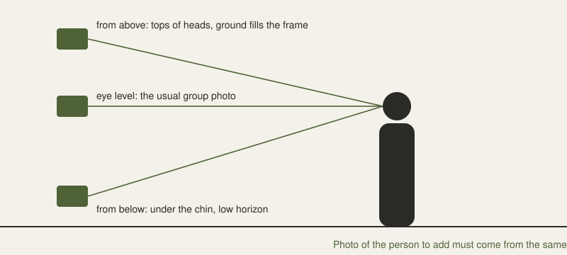

# 1. Camera height and focal length

## The quick test

Look at where the camera was relative to the people:

| Clue in the group photo | Camera height |
|---|---|
| You see the tops of heads and shoulders; the ground fills the lower half | From above (someone standing on a chair, a drone, a balcony) |
| Eyes roughly in the upper third, horizon behind the people at about eye height | Eye level (the usual case) |
| You see under chins; the horizon is low, near the waist | From below (camera on a table, a child taking the photo) |

Now check the photo of the person you want to add. It must come from the same row of this table.

## Focal length

Phone selfies are taken at arm's length with the wide main or front camera. At 40–50 cm, the nose is noticeably closer to the lens than the ears, so faces look rounder and noses larger. A group photo taken from 2–4 m does not have that distortion.

| Photo of the person | Typical distance | Distortion | Match with a group photo |
|---|---|---|---|
| Front-camera selfie at arm's length | 30–50 cm | Strong: rounder face, larger nose, smaller ears | Poor |
| Mirror selfie | 1–1.5 m | Moderate | Fair, but often from chest height |
| Photo taken by someone else, main camera | 2–3 m | Low | Good |
| Photo taken by someone else, 2× or 3× lens | 2–4 m | Very low | Best |

**Fix:** if the only photo you have is a close selfie, crop it to the face and upper body and let the rest of the body be rebuilt (AI) or replaced (by hand), so the stretched perspective of the arms and shoulders does not show.
