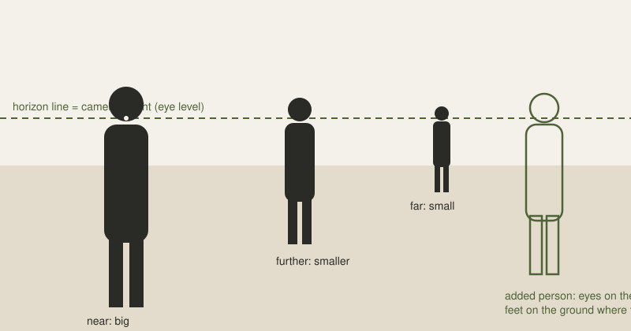

# 2. Horizon line, scale and placement

## The rule

When the camera is at eye level, **the eyes of everyone standing on the same flat ground sit on the horizon line**, no matter how far away they are. Further people are smaller, but their eyes stay on the line.

So to place the added person:

1. Find the horizon (where a flat ground would meet the sky, even if a wall hides it). With an eye-level camera, it runs through the eyes of the standing adults.
2. Scale the person so their eyes land on that line **and** their feet land on the ground where you want them to stand.
3. If they cannot satisfy both at once, they are standing at a different distance than you think: move them forward (bigger) or back (smaller) until they do.

| Situation | Where their eyes go |
|---|---|
| Same height as the others, standing on the same ground | On the horizon line |
| Taller or shorter adult | Slightly above or below the line, by the height difference at that distance |
| Child | Below the line |
| Sitting | Below the line, matching other seated people |
| Camera from above | Everyone's eyes are below the horizon; the closer, the further below |

## Placement that looks real

- End of a row, half behind a shoulder, or a natural gap.
- Overlap with a neighbour (shoulder in front of shoulder) hides edges and makes depth readable.
- Avoid placing the person exactly centred or exactly at the frame edge.

The [how-to guide](https://addpersontophoto.org/how-to-add-a-person-to-a-photo) has worked examples for full-body vs waist-up group photos.
