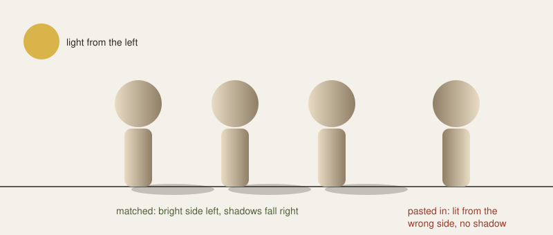

# 3. Light direction, shadows and color temperature

## Direction

Look at the faces in the group photo: which cheek is brighter, which side of the nose casts a shadow? The person you add must be lit from the same side. Mirroring photo 2 horizontally is a legitimate fix if nothing in it reads backwards (text, a parting in the hair you know).

## Quality

| Light in the group photo | Shadows | A photo of the person that matches |
|---|---|---|
| Midday sun | Hard, short, dark | Outdoor sun, any time near noon |
| Late afternoon / golden hour | Long, warm, soft-edged | Outdoor, late in the day, or near a window with warm light |
| Open shade / overcast | Barely visible, very soft | Outdoor shade, cloudy day, big window |
| Indoor bulbs | Soft, warm/yellow, several directions | Indoor evening photos |
| Flash | Hard shadow right behind the person, bright face | Another flash photo |

## Color temperature

| Scene | Approx. color temperature | What skin looks like |
|---|---|---|
| Candle / warm bulb | 2,000–3,000 K | Orange-yellow |
| Golden hour | 3,000–4,000 K | Warm, glowing |
| Daylight | 5,000–6,000 K | Neutral |
| Overcast | 6,000–7,000 K | Slightly cool |
| Open shade | 7,000–9,000 K | Blue-ish |

Correct the added person until their skin tone matches the person standing next to them, compared side by side at 100%.

## Shadows

- **Ground shadow:** same direction and length as the others'. Under soft light it is just a darker patch under the feet.
- **Contact shadow:** a thin dark line where shoes meet the ground. Without it, people float.
- **Cast shadow on neighbours:** if the person stands between the light and a neighbour, a soft shadow falls on the neighbour too.
